  

  <b>Fynnland</b>: games, programs and mods I build. The games run in your browser, free and without ads.

  <a href="https://fynn.land"><b>fynn.land</b></a> &nbsp;·&nbsp;
  <a href="https://discord.gg/JTHPxAxFpE">Discord</a> &nbsp;·&nbsp;
  <a href="https://www.youtube.com/@Fynnland">YouTube</a>

## Projects

| Project | What it does | Links |
|---|---|---|
| **Tobuuy** | Browser game: buy, expand, expropriate, take the crown. | [Play](https://fynn.land/tobuuy/) |
| **Neon Velocity** | Browser game: run, jump, dash and outrun the crunch. | [Play](https://fynn.land/neon-velocity/) |
| **Fleech** | Voice dictation: hold a key, speak, let go, and the text lands in the active field. | [Page](https://fynn.land/fleech/) · [Source](https://github.com/FynnXland/fleech) |
| **FluneIt** | Control the volume of a single app with your keyboard's volume wheel. | [Page](https://fynn.land/fluneit/) · [Source](https://github.com/FynnXland/FluneIt) |
| **Foldwing** | Drag a file into the window, copy the link. The file stays on your PC. | [Page](https://fynn.land/foldwing/) · [Source](https://github.com/FynnXland/foldwing) |
| **fynn-mods** | Six mods for Claude Code: limit-bars, cost-ledger, sidekick, quick-replies, clawd-buddy and tune-strip. | [Page](https://fynn.land/fynn-mods/) · [Source](https://github.com/FynnXland/fynn-mods) |

<h3 align="center">🛠️ Tools I use</h3>

  

<h3 align="center">🐍 My contributions, hunted by a snake (new route every day)</h3>

  <picture>
    <source media="(prefers-color-scheme: dark)" srcset="https://raw.githubusercontent.com/FynnXland/FynnXLand/refs/heads/output/github-snake-dark.svg">
    <source media="(prefers-color-scheme: light)" srcset="https://raw.githubusercontent.com/FynnXland/FynnXLand/refs/heads/output/github-snake.svg">
    
  </picture>

